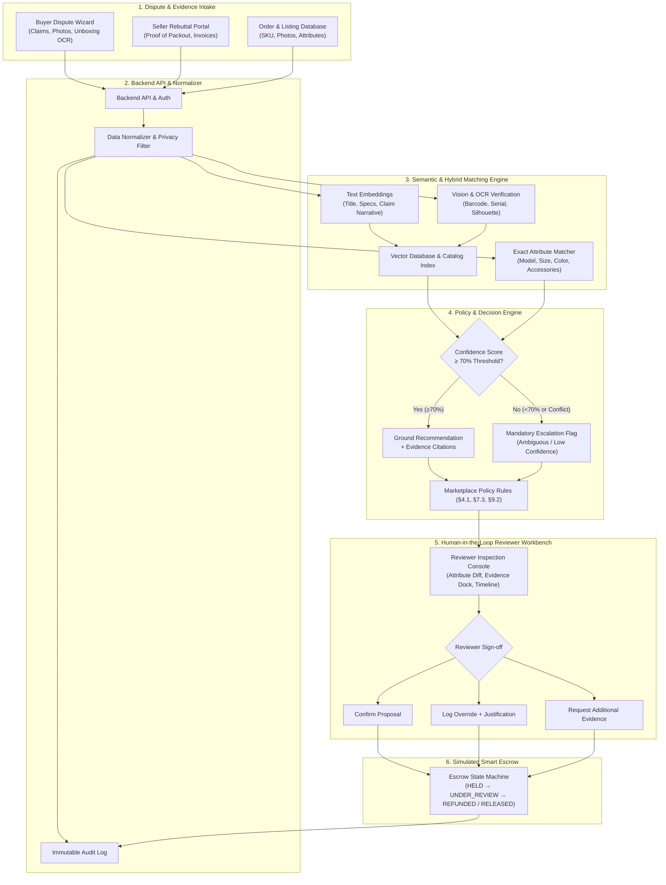

# Veroxa: Semantic Product-Matching Escrow Bot
### Evidence-Led Marketplace Dispute Resolution & Safe Escrow Adjudication

[](https://github.com/SPSQZ/Veroxa)
[](LICENSE)
[](#system-architecture)
[](frontend/)

**Veroxa** is an intelligent, evidence-grounded dispute resolution assistant designed for peer-to-peer and multi-vendor marketplaces. It cross-examines buyer claims against original listing specifications, order details, high-resolution photo evidence, chat transcripts, and marketplace return policies to adjudicate disputes fairly before funds are released from escrow.

---

## 🎯 Executive Summary & Core Principle

In e-commerce marketplaces, disputes surrounding *"Item Not as Described"*, wrong variants, missing bundled accessories, and counterfeit goods are often slow, costly, and subjective. Veroxa transforms this process into a transparent, auditable, and automated investigation workflow.

> ⚖️ **The Golden Design Principle:**  
> **The bot recommends; it never makes silent, irreversible financial decisions.**  
> Every recommendation produced by the AI engine links directly back to verified evidence artifacts and versioned marketplace policy clauses. Irreversible financial actions (such as escrow payout or buyer refund) strictly require authorized human reviewer confirmation or audited override.

---

## 🏛️ System Architecture & Workflow



---

## 👥 Team Workstreams & Module Breakdown

The Veroxa platform is partitioned across four specialized technical leads:

### 1. AI & Semantic Matching Lead (Member 1)
* **Text Embeddings & Vector Search:** Embedding generation for catalog items, dispute statements, and return criteria.
* **Hybrid Matching Logic:** Blends cosine vector similarity with deterministic checks across SKU, brand, model code, size, color, item condition, and bundled accessories.
* **Multi-Modal Vision & OCR:** Visual anomaly detection, box label barcode OCR extracts, and serial number cross-referencing.
* **Test Fixtures:** Benchmarks handling edge cases like deceptive paraphrasing, near-duplicate listings, wrong variants, and ambiguous descriptions.

### 2. Backend, Data & Escrow Workflow Lead (Member 2)
* **Relational Data Layer:** Database schemas for users, listings, orders, disputes, evidence bundles, and audit records.
* **Dispute Orchestrator API:** RESTful endpoints for dispute ingestion, evidence processing, semantic scoring, reviewer decisions, and chronological history.
* **Simulated Escrow State Machine:** Strict, guarded transitions preventing unauthorized or out-of-order financial state modifications.
* **Access Control & Privacy:** Role-based access control (RBAC), file upload sanitation, and data minimization.

### 3. Frontend & Reviewer Experience Lead (Member 3)
* **Reviewer Inspection Workbench (`/review/:caseId`):**
  * *Semantic Attribute Matrix:* Side-by-side spec comparison table with `MATCH`, `MISMATCH`, and `UNVERIFIED` indicators.
  * *Multi-Modal Evidence Dock:* Integrated image lightbox, OCR inspection, chat log transcripts, and policy citations.
  * *AI Recommendation & Citations Card:* Real-time confidence gauge, policy reasoning summary, and model metadata.
  * *Chronological Audit & Escrow Timeline:* Event stream logging every participant action and state transition.
* **Human Adjudication System:** One-click confirmation, multi-party evidence request modal, and mandatory override justification logging.
* **Parties Intake Interfaces:** Buyer dispute submission wizard (`/dispute/new`) and Seller rebuttal portal (`/dispute/:id/respond`).
* **Resilience States:** High-visibility low-confidence escalation banners, skeleton loaders, and empty/error handling.

### 4. Evaluation, Safety & Pitch Lead (Member 4)
* **Synthetic Test Evaluation:** Balanced benchmark dispute suites (clear matches, deliberate mismatches, missing parts, conflicting claims, luxury counterfeits).
* **Metrics Measurement:** Accuracy tracking for Top-$k$ candidate retrieval, false-match rates, evidence traceability, and latency.
* **Responsible AI & Safety Audits:** Verification that every recommendation cites exact policy sections and that low-confidence (<70%) disputes are forcibly escalated.
* **Demonstration & Pitch Packaging:** Live interactive case demos illustrating automated routing, confidence gates, and simulated escrow execution.

---

## 🔒 Simulated Escrow State Machine

Veroxa safeguards funds by modeling a state machine that mirrors smart escrow protocols:

| State | Description | Permitted Transitions |
| :--- | :--- | :--- |
| `HELD` | Buyer payment locked in escrow upon order completion. | $\rightarrow$ `UNDER_REVIEW`, `AWAITING_EVIDENCE`, `RELEASED` |
| `AWAITING_EVIDENCE` | Pending required photos, receipts, or statements from buyer or seller. | $\rightarrow$ `UNDER_REVIEW`, `HELD` |
| `UNDER_REVIEW` | Semantic comparison completed; case active in Reviewer Workbench. | $\rightarrow$ `RETURN_IN_PROGRESS`, `REFUNDED`, `RELEASED`, `AWAITING_EVIDENCE` |
| `RETURN_IN_PROGRESS` | Return label generated; escrow remains locked pending return delivery. | $\rightarrow$ `REFUNDED`, `UNDER_REVIEW` |
| `RELEASED` | Dispute decided in seller's favor (or claim dismissed); funds disbursed to seller. | *Terminal state* |
| `REFUNDED` | Dispute decided in buyer's favor; funds returned to buyer from escrow. | *Terminal state* |

---

## 📊 Evaluation Benchmarks & Metrics

| Metric | Target | Verification Method in Veroxa |
| :--- | :---: | :--- |
| **Top-$k$ Match Accuracy** | $\ge 90\%$ | Correct item/variant ranked at top-1 or top-3 across synthetic dispute callsets. |
| **False-Match Rate** | $< 5\%$ | Rigorous testing against near-identical variants, subtle counterfeits, and misleading claims. |
| **Evidence Traceability** | $100\%$ | Every AI proposal contains citations referencing specific evidence items and policy clauses. |
| **Safety Escalation Gate** | $100\%$ | Any case with confidence $<70\%$ or contradictory evidence is locked from automatic closure and flagged for human review. |
| **End-to-End Latency** | $< 2.5\text{s}$ | Median duration from evidence intake to vector ranking and grounded recommendation generation. |

---

## 📁 Repository Structure

```text
Veroxa/
├── README.md                      # Comprehensive project documentation
├── LICENSE                        # MIT License
├── .gitignore                     # Repository-wide ignore rules
├── .gitattributes
│
├── frontend/                      # Web Application (React 18 + Vite + Tailwind v4 + TypeScript)
│   ├── src/
│   │   ├── types/                 # Shared data contracts (Dispute, Escrow, Evidence, Policies)
│   │   │   ├── dispute.ts
│   │   │   └── escrow.ts
│   │   ├── services/
│   │   │   ├── mockData.ts        # 4 balanced benchmark evaluation scenarios
│   │   │   └── disputeStore.ts    # Reactive state store with audit trail persistence
│   │   ├── components/
│   │   │   ├── common/            # Header, Badges, Modals, Scenario Switcher
│   │   │   ├── review/            # Workbench, Attribute Matrix, Evidence Dock, Timeline, Actions
│   │   │   └── intake/            # Buyer Dispute Wizard, Seller Rebuttal Portal
│   │   ├── App.tsx                # Master router and notification container
│   │   └── main.tsx               # Client entrypoint
│   ├── package.json
│   ├── vite.config.ts
│   └── tsconfig.json
│
├── backend/                       # API Service & Dispute Orchestrator (FastAPI / Node.js)
│   └── (Dispute ingestion, evidence uploads, escrow state manager)
│
├── matching/                      # AI & Semantic Matching Engine
│   └── (Text embeddings, vector search, multi-modal OCR, attribute rule checks)
│
├── policy/                        # Marketplace Policy Rules & Decision Gates
│   └── (Dispute rules, confidence thresholds, citation generator)
│
├── database/                      # Relational Schema & State Migrations
│   └── (Postgres/SQLite schemas, audit event persistence)
│
├── sample_data/                   # Synthetic benchmark datasets & test fixtures
│   └── (Paired listings, buyer photos, unboxing OCR, and chat logs)
│
└── tests/                         # Automated test suites
    └── (Unit tests, attribute matching tests, escrow state transition tests)
```

---

## 🧪 Included Benchmark Demo Scenarios

The system includes 4 pre-configured synthetic cases representing the core dispute taxonomy:

1. **`CASE-8091` — Clear Wrong Item / Silhouette Mismatch:**
   * *Claim:* Buyer ordered Nike Dunk Low Panda; package contained Nike Air Force 1 Triple White.
   * *Analysis:* OCR extracts AF1 box label (`CW2288-111`); computer vision flags midsole discrepancy.
   * *Outcome:* High Confidence ($94\%$) $\rightarrow$ `REFUND_BUYER` upon return.

2. **`CASE-8092` — Missing Bundled Essential Accessory:**
   * *Claim:* Sony WH-1000XM5 headphones delivered without the advertised hard travel case and audio cable.
   * *Analysis:* Listing title explicitly guarantees accessories; unboxing photo proves omission.
   * *Outcome:* Moderate Confidence ($86\%$) $\rightarrow$ `PARTIAL_REFUND` (\$65 accessory settlement).

3. **`CASE-8093` — Ambiguous High-Value Dial Authenticity:**
   * *Claim:* Vintage Omega Seamaster (\$1,850); buyer alleges aftermarket redial; seller produces Swiss certificate.
   * *Analysis:* Macro photos suffer optical distortion; conflicting credentialed claims.
   * *Outcome:* Low Confidence ($44\%$) $\rightarrow$ **Mandatory Human Escalation Gate triggered under Policy §9.2**.

4. **`CASE-8094` — Counterfeit Luxury Replica:**
   * *Claim:* Gucci GG Marmont bag; improper serif debossing and incorrect hardware alloy.
   * *Analysis:* Serial number matches known replica batch in Authenticator Database.
   * *Outcome:* High Confidence ($89\%$) $\rightarrow$ `REFUND_BUYER` under Anti-Counterfeit Policy §3.4.

---

## 🚀 Quick Start Guide

### Running the Frontend Dashboard

```bash
# 1. Navigate to the frontend directory
cd frontend

# 2. Install dependencies
npm install

# 3. Start the development server
npm run dev
```

Visit `http://localhost:5173/` in your browser. You can use the **Demo Scenario Selector** in the header to switch between benchmark cases instantly or submit custom claims via the Buyer and Seller portals.

### Verifying the Production Build

```bash
cd frontend
npm run build
npm run preview
```

---

## 🛡️ Responsible AI, Security & Compliance

* **Traceable Auditability:** All model versions, similarity metrics, evidence references, and reviewer overrides are immutably timestamped in the case log.
* **No Autonomous Funds Movement:** Financial transfers cannot occur without explicit human authorization.
* **Privacy By Design:** PII (personally identifiable information) is stripped from embeddings; buyer/seller communications remain scoped strictly to case investigators.

---

## 📄 License
This project is licensed under the [MIT License](LICENSE).
